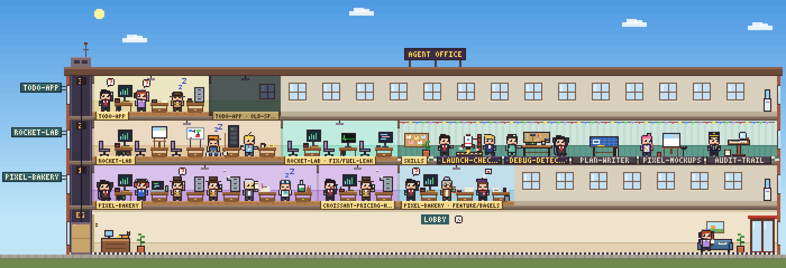

# agent-office

**Your Claude Code agents, as tiny pixel-art office workers.**



You have three Claude Code sessions open, two of them spawned sub-agents, one is quietly waiting for an answer, and you have lost track. agent-office turns all of that into an office building: each repo is a floor, each session is a room, and every sub-agent is a small figure at a desk. Reviewers wear grey suits, testers wear lab coats, and whoever needs you raises a hand.

It runs locally, reads `~/.claude` without touching it, and needs no setup to try.

```sh
npx agent-office --demo --open   # a made-up office, no Claude Code needed
npx agent-office --open          # your real one
```

## What you're looking at

| In the picture | Meaning |
|---|---|
| a floor | a repository (or any working directory) |
| a room | one running Claude Code session; its sign shows the `/rename` name, or repo and branch |
| the person in the suit | the lead, i.e. the session itself |
| everyone else | sub-agents, dressed by [role](#roles) |
| a speech bubble with `?` | waiting for you |
| `zZ` | finished, napping; goes home after 30 minutes |
| a dark room | the session ended (stays dark for 30 minutes) |
| the room full of machines | the [skill corner](#skill-corner): someone is using a skill |
| small monitors under a desk | [background shells](#background-shells) that agent started |

## Quick start

```sh
npx agent-office            # serves http://127.0.0.1:4242
npx agent-office --open     # also opens the browser
npx agent-office --demo     # fake data, no ~/.claude needed
npx agent-office --port 5000
```

Requires Node 20 or newer. If the port is taken, pick another with `--port`. Other flags: `--claude-home <dir>` (default `~/.claude`, or the `CLAUDE_HOME` env var) and `--with-laya` (see [below](#optional-laya-classifier)).

Out of the box the status (working, waiting, done) is a well-informed guess. For exact status, install the small [plugin](#plugin-exact-status).

## How it works

agent-office reads `~/.claude` read-only:

- live `claude` processes and their session files in `~/.claude/sessions/` (session id, working directory and session name),
- session transcripts (what the agent is doing right now),
- sub-agent meta files (name and description of each sub-agent, used for role detection).

Every running Claude Code session gets its own room, even when several sessions work in the same checkout or worktree; rooms of the same directory sit side by side. The room sign shows the name you gave the session with `/rename` (from the session file, or the transcript's `custom-title` entry). Unnamed sessions are labelled with repo and branch (main checkout) or the worktree directory, and a second unnamed session in the same directory gets `#2`. A room belongs to the Claude Code process, so `/clear` keeps it. When a session ends, its room stays dark for 30 minutes.

The lead figure is named after the session name when one is available, otherwise after the transcript's title, otherwise after the room.

From these it derives a status per figure (working, waiting for you, finished, sleeping) using heuristics, for example how recently the transcript was written and whether the last message is a question or a pending tool call. The snapshot is pushed to the browser over a local stream.

## Roles

A sub-agent's role is picked from its name and description by keyword rules. Anything that matches nothing becomes an `intern` and gets a coffee.

| Role id | Look | Matches (default keywords) |
|---|---|---|
| `builder` | blue hoodie, headphones | implement, builder, coder |
| `detective` | trench coat, fedora | explore, research, search, fetch |
| `critic` | grey suit, red pen | review |
| `lab` | white lab coat | test, qa |
| `archivist` | cardigan, gold chain | memory, story, notes, obsidian |
| `poet` | turtleneck, red scarf | writ, pr-writer, docs, blog, commit |
| `artist` | purple, apron | design, figma, ui, frontend |
| `strategist` | navy suit | plan, architect, brainstorm |
| `janitor` | overalls, orange cap | deploy, ops, config, cleanup, bash |
| `doctor` | scrubs, stethoscope | debug, diagnos, fix bug |
| `guard` | uniform, gold badge | security, audit |
| `secretary` | blouse, headset | mail, calendar, todo, time |
| `intern` | plain tee, coffee | fallback |

Keywords match at the start of a word (so `ui` does not match `build`) and as prefixes (`review` matches `reviewer`). The defaults live in `roles/default.json`. The agent name is checked first, then the description; within each, the first role that matches wins, in the order roles appear in `roles/default.json` (builder, critic, lab, detective, archivist, strategist, doctor, guard, artist, poet, janitor, secretary).

### Customizing roles

Create `~/.config/agent-office/roles.json`. Roles are replaced per id; you can override `keywords`, `label`, `description` and `laya` (the description used by the classifier). Unknown role ids are ignored, and a broken file is ignored too. Overriding a role keeps its position in the match order.

Keywords are regular-expression fragments (case-insensitive), so characters such as `+`, `.`, `(` or `?` must be escaped: write `"c\\+\\+"` in JSON for `c++`. A role whose keywords do not form a valid pattern is skipped.

```json
{
  "roles": {
    "lab": { "keywords": ["test", "qa", "e2e", "playwright"] },
    "janitor": { "keywords": ["deploy", "terraform", "ci"] }
  }
}
```

## Skill corner

When a lead or sub-agent is working with a skill, its figure walks over to a machine in a "SKILLS" room on the right side of the floor and uses it there. The room only exists while someone on that floor has an active skill, and each skill in use gets its own machine with a name sign (two skills of the same category are two machines that look alike).

What counts as a skill use (the latest one wins):

- a `Skill` tool call in the transcript (for example `acme:deploy-helper`),
- a slash command you typed, such as `/my-review`. Built-in commands like `/clear`, `/model` or `/mcp` are not skills and are ignored (see `ignoreCommands` below).

A skill is shown as active only while the figure is busy or waiting for you (sub-agents: busy) and the skill was used less than 15 minutes ago. Once the agent goes idle or finishes, or the 15 minutes pass, the figure walks back to its desk. To avoid flicker, a figure only leaves the machine after the skill is missing from two snapshots in a row and has not been seen for 10 s, and an unused machine stays on the floor, switched off, for 15 minutes after its last use. If the skill is used again in that time, the figure walks back to the same machine.

Each skill gets a category by keyword rules, matched against the skill name (including a plugin prefix) first and then against its description from Claude Code's skill listing (only keywords of 4 or more characters, otherwise nearly everything matches). Matching works like for roles: keywords match at the start of a word, and the first category in the table wins. So `writing-plans` is `planning` and `test-driven-development` is `testing`. A sub-agent that would otherwise be an `intern` takes the look of its skill's category (`ideas`/`planning` as strategist, `debugging` as doctor, `review` as critic, `testing` as lab, `git`/`writing` as poet, `design` as artist, `running` as janitor); explicit role rules still win.

| Category | Keywords | Machine |
|---|---|---|
| `ideas` | brainstorm, grill, idea | bean-bag circle with a light bulb |
| `planning` | plan | blueprint table |
| `debugging` | debug, diagnos, bug | workbench with a soldering iron |
| `review` | review, audit | magnifier desk |
| `testing` | test, tdd, verif | test rig with a traffic light |
| `git` | commit, pr, branch, merge | post station with parcels |
| `writing` | doc, writ, blog, readme | typewriter |
| `design` | design, figma, artifact, ui | easel |
| `running` | run, deploy, loop, schedule | rocket launch pad |
| `other` | none (fallback) | vending machine ("Skill-O-Mat") with the skill name on the sign |

The defaults live in `roles/skills.json`. If you start with Laya enabled, skills the keywords cannot place are classified by Laya as well (one question over the categories, using `name: description`); otherwise they land in `other`. Results are cached in `~/.cache/agent-office/skills.json`.

### Customizing skills

Create `~/.config/agent-office/skills.json`. Like the role override it works per id: a category may override `keywords`, `label` and `laya`; unknown category ids and a broken file are ignored. Keywords are case-insensitive regular-expression fragments, so escape special characters. `ignoreCommands` adds slash commands (without the `/`) to the built-in list of commands that should not count as skills.

```json
{
  "categories": {
    "running": { "keywords": ["run", "deploy", "ship"] },
    "git": { "keywords": ["commit", "pr", "my-release"] }
  },
  "ignoreCommands": ["my-timer", "my-standup"]
}
```

## Staff

Sub-agents of the same type in one session are one recurring employee, not a new hire per run. A `reviewer` that was started five times is one persona with five runs; the tooltip shows its role, the run count (e.g. `5. Einsatz`) and up to three recent tasks. If two instances of a type run at the same time, the second one shows up as a colleague named `reviewer 2` (and so on). Personas never span sessions, so two worktrees have separate teams.

- An employee who was done or idle and starts working again stretches and grabs a coffee before sitting down (staff only; the lead just keeps working on the next prompt).
- An instance that has not written anything for more than 30 minutes counts as ended (crashed or aborted); otherwise a dead sub-agent would block its desk forever. Pauses under 30 minutes still count as the same running agent: it keeps its own figure and shows as idle, not done.
- A persona goes home after its last run has been finished for 30 minutes.

## Background shells

When an agent runs a command in the background (a dev server, a test watcher, a log tail), a small monitor appears under its desk, one per running shell. Three monitors fit; with more, the third one glows amber. When a background shell ends with status `failed`, a red screen flashes for a few seconds. The tooltip lists the running shells with their description (or the shortened command) and how long they have been running.

A shell counts as running from the moment Claude Code reports it as backgrounded until a completion notification (`completed`, `failed`, `killed`, `stopped`) or a `TaskStop` call shows up in the transcript. Because a dev server can run for hours, agent-office reads each transcript completely once and then only the appended part. Shells of a finished sub-agent are not shown, and for a resumed session only shells started by the current process count.

## Plugin (exact status)

The plugin registers hooks (SessionStart, SessionEnd, UserPromptSubmit, PreToolUse, Stop, Notification, SubagentStop) that POST each event to the local server. This replaces the guessing for "waiting for you" and "finished". The hook script exits quietly and quickly when no server is running. It finds the server port via `AGENT_OFFICE_PORT`, then `~/.config/agent-office/server.json`, then 4242.

In Claude Code:

```
/plugin marketplace add /path/to/agent-office
/plugin install agent-office@agent-office
```

`npx agent-office plugin` prints the marketplace path for your installation. `marketplace add` also accepts a git repository URL.

Manual fallback: add the hooks to `~/.claude/settings.json` yourself, with an absolute path to `plugin/hooks/send-event.sh`. Repeat the entry for each event listed above:

```json
{
  "hooks": {
    "Notification": [
      { "hooks": [ { "type": "command", "command": "/absolute/path/to/agent-office/plugin/hooks/send-event.sh", "async": true, "timeout": 2 } ] }
    ],
    "Stop": [
      { "hooks": [ { "type": "command", "command": "/absolute/path/to/agent-office/plugin/hooks/send-event.sh", "async": true, "timeout": 2 } ] }
    ]
  }
}
```

The script needs `sh` and `curl`; `jq` is used if present but not required.

## Optional: Laya classifier

Some sub-agents have names no keyword rule could ever guess. For those you can add [Laya](https://pypi.org/project/laya/), a local zero-shot text classifier. It is **off by default**: agent-office sends no request to it unless you start with `--with-laya` or set `LAYA_URL` explicitly. Keyword rules always run first; only agents they cannot place go to Laya. Treat it as a hint: zero-shot accuracy is limited, and results below the confidence threshold fall back to `intern`.

```sh
npx agent-office laya        # run the Laya server on its own
npm run laya                 # same, from a checkout
npx agent-office --with-laya # start Laya together with agent-office
```

Requires [`uv`](https://docs.astral.sh/uv/) (`brew install uv`). Environment variables:

| Variable | Default | Meaning |
|---|---|---|
| `LAYA_URL` | unset (`http://127.0.0.1:8000` with `--with-laya`) | where agent-office finds the Laya server; setting it enables Laya |
| `LAYA_MODEL` | server default | model name sent to Laya |
| `LAYA_THRESHOLD` | `0.5` | minimum confidence to accept a Laya result |

If you run `laya-serve` yourself (e.g. `npx agent-office laya` in another terminal), set `LAYA_URL` so agent-office uses it. agent-office checks `GET /health` every 60 s and only uses Laya while that answers with a 2xx status. If Laya is not running, agent-office simply uses the keyword rules.

## Privacy

The office has no windows to the outside.

- The server binds to `127.0.0.1` only and checks the `Host` and `Origin` headers, so other machines and other websites cannot talk to it.
- `~/.claude` is only read, never written.
- No telemetry, no analytics, no network calls to third parties. Nothing leaves your machine.
- Laya is off unless you enable it (`--with-laya` or `LAYA_URL`). When enabled, sub-agent names and descriptions are sent to that Laya server, which normally runs locally.
- `--with-laya` and `agent-office laya` run `uvx`, which on first use downloads the `laya` package and its dependencies from PyPI and the classifier model from Hugging Face. After that they run from the local cache. The model download uses plain HTTPS (`HF_HUB_DISABLE_XET=1` is set by default because the Xet CDN download tends to fail with `CAS Client Error`); set `HF_HUB_DISABLE_XET=0` to opt back in.
- The app writes only a port file in `~/.config/agent-office/` and a role cache and a skill cache in `~/.cache/agent-office/`.

## Known limits

- It relies on Claude Code internals (process list, transcript and sub-agent file layout) that can change between releases. When an update moves the furniture, figures may sit in the wrong place until agent-office catches up.
- macOS and Linux only for now.
- Without the plugin, heuristics may misjudge long-running tools (a quiet transcript looks like "finished").
- Role detection is a best guess from names and descriptions, and so is the skill category.
- A background shell whose process dies without Claude Code noticing keeps its monitor until the session ends.
- Some UI labels (tooltips, role names) are in German.

## Development

```sh
npm install
npm test             # vitest
npm run typecheck    # tsc --noEmit
npm run build        # bundles to dist/
npm run dev          # server from source (tsx)
npm run demo         # demo data, opens the browser
```

The sprite sheet of all roles and machines is served at `/sprite-sheet.html`. Append `?hour=13` to the main page to pin the sky clock to a given hour (handy for screenshots).

If you work on agent-office with Claude Code, [`CLAUDE.md`](CLAUDE.md) and the project skills in [`.claude/skills/`](.claude/skills/) cover the architecture, testing, running the app and what to do when a Claude Code update changes its file formats. The README tables above are checked against `roles/*.json` by `test/readme.test.ts`, so a changed keyword without a README update fails the tests.

## License

MIT, see [LICENSE](LICENSE).
